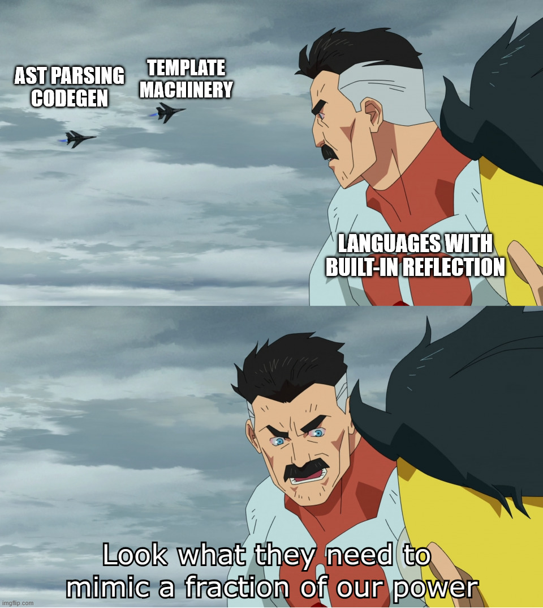

<!-- pages:introduction:start -->
# Omnirefl

A C++ reflection tool built for a seamless experience without macros* or UB. <sub>(C++11 minimum.)</sub><br>
<sub>* optional QoL and compatibility</sub>

<p align="center">
  
  <br>
  <sub>Obligatory self-reflection meta joke.</sub>
</p>
<!-- pages:introduction:end -->

<!-- pages:experience:start -->
## Seamless Experience

1. Add `omni_reflected_target(...)` for a CMake target.
2. Use `omni::reflected_call(...)` where reflection is needed.

Everything else remains regular C++. No macros*, compiler-specific tricks,
undefined behavior, or manual regeneration are required.<br>
<sub>* Reflection uses AST instrumentation. Macros are optional conveniences or compatibility fallbacks.</sub>

Types can be declared and reflected directly in the same `.cpp`. No dedicated
declaration headers, schemas, annotations, or checked-in metadata files are
required; generated metadata remains a build artifact.
<!-- pages:experience:end -->

<!-- pages:sneak-peek:start -->
## Sneak Peek

A simple recursive type reader explores discoverable dependencies and prints
their metadata. The [complete runnable example](extras/examples/sneak_peek/main.cpp)
also demonstrates modifying fields through reflection.

```cpp
// One .cpp; no declaration headers, metadata files, or reflection macros.

/** This example intentionally uses C++23 syntax and library facilities to
 * reduce verbosity. The reflection APIs also support C++11. */

void print_indented(std::string_view text);
std::string format_annotation(std::string_view annotation, unsigned indent = 0);

/** Selected metadata queries used by print_reachable_records below.
 * This (optional) namespace marks helpers that must not be used outside
 * a reflected scope. Instrumentation checks out-of-scope queries
 * (best effort). */
namespace reflected_scope {

// Showcase data-member metadata queries within a reflected scope.
std::string format_qualifiers(omni::data_member_meta auto field) {
  constexpr auto format_bitfield = [](omni::data_member_meta auto field) {
    if constexpr (field.is_bitfield())
      return std::format("bitfield({}) ", field.bit_width());
    else
      return "";
  };

  // Metadata names, type names, and property queries are constexpr.
  return std::format("{}{}{}{}{}",
    field.is_static() ? "static " : "",
    field.is_const() ? "const " : "",
    field.is_mutable() ? "mutable " : "",
    field.is_volatile() ? "volatile " : "",
    format_bitfield(field));
}

std::string format_enum(omni::enum_meta auto e) {
  using namespace std::string_view_literals;

  constexpr auto enumerator_name = [](auto enumerator) {
    const auto &[value, name] = enumerator;
    // Enumerator names are string literals with static storage.
    return std::string_view{name};
  };

  return std::format("[{}]",
    e.enumerators()
      | std::views::transform(enumerator_name)
      | std::views::join_with(", "sv)
      | std::ranges::to<std::string>());
}

// Non-empty documentation includes its separating line break.
std::string format_documentation(auto meta) {
  const std::string_view text = meta.documentation();
  return text.empty() ? "" : std::format("{}\n", format_annotation(text));
}

template <typename ValueMeta>
  requires (omni::data_member_meta<ValueMeta>
    || omni::function_param_meta<ValueMeta>
    || omni::function_return_meta<ValueMeta>)
std::string format_type_name(ValueMeta meta) {
  if constexpr (omni::is_reflected<typename ValueMeta::type>::value)
    return std::format("{} (resolves to {})",
      meta.spelled_type_name(),
      // qualified_type_name() also includes enclosing namespaces.
      omni::meta_for<typename ValueMeta::type>::type_name());
  else
    /** Fall back to the data member's or function parameter's source spelling
     * when its type is not reflected. */
    return meta.spelled_type_name();
}

std::string format_function_param(omni::function_param_meta auto param) {
  const std::string_view name = param.name();
  const std::string_view documentation = param.documentation();

  return std::format("{}{}{}",
    format_type_name(param),
    name.empty() ? "" : std::format(" {}", name),
    documentation.empty() ? "" : std::format(" [{}]", documentation));
}

/** Render an available default value.
 * ```cpp
 * int make_value();
 *
 * struct defaults {
 *   int arithmetic = 8 * 100 + 15; //< default_value() available
 *   int computed = make_value();  //< default skipped with a warning
 * };
 * ``` */
template <omni::data_member_meta Field>
  requires (Field::has_default_value_access())
std::string format_default_value(Field field) {
  return std::format("{}", field.default_value());
}

// Defined below the model to keep formatting glue out of the query examples.
template <omni::data_member_meta Field>
std::string format_field(Field field);

// Defined below the model to keep formatting glue out of the query examples.
std::string format_function(omni::function_meta auto func);

void print_members(omni::record_meta auto record) {
  namespace fn = omni::fn;

  record.accessible_data_members()
    | fn::each([](omni::data_member_meta auto field) {
        /** Special case: `omni::function_t` allows reflecting free functions
         * "bound" as data members. */
        if constexpr (field.has_callable_metadata())
          print_indented(format_function(field.callable_metadata()));
        else
          print_indented(format_field(field));
      });

  record.accessible_member_functions()
    | fn::each([](omni::function_meta auto func) {
        print_indented(format_function(func));
      });
}

} // namespace reflected_scope

/** Print reachable records depth-first using the query helpers above.
 * The traversal is implemented below. */
struct print_reachable_records {
  template <omni::record_meta Root>
  void operator()(Root) const;
};

template <typename T>
void print_reflection() {
  /** `reflected_call` makes metadata for `T` and its type dependencies
   * available inside the visitor's `operator()` and the functions it calls.
   * The visitor can also be a generic lambda with an explicit return type. */
  omni::reflected_call(print_reachable_records{}, omni::type<T>);
}

/** Omnirefl reflects globally accessible, named records (structs, classes, or
 * unions) and enums on demand. */

namespace oceanic {
// Declaration comments are available as reflection metadata.
struct vessel { //< Discovered as the `mapped_type` of `fleet<T>::vessels`.
  // Nested structs are supported recursively inside non-template records.
  struct position { //< Discovered via the `location` data member.
    using degrees = double;

    degrees latitude = 0;
    degrees longitude = 0;
  };

  position location;

  enum class propulsion { sail, motor, hybrid };
  propulsion drive{};

  // Reflected data-member properties are queryable.
  mutable std::string name = "before"; //< `.is_mutable()` is true.

  /** Public static and non-static member functions are reflected.
   * Parameter and return types join dependency discovery.
   * Overloaded member functions are skipped with a warning.
   * Doxygen parameter descriptions, such as `@param` or `\param[in]`, are
   * available through parameter metadata. */

  /** Check proximity.
   * @param other Other position.
   * @return Whether the positions are near. */
  bool is_near(position other) const {
    return location.latitude == other.latitude
      && location.longitude == other.longitude;
  }
};

/** Measure a distance.
 * @param scale Multiplier.
 * @return The scaled distance. */
double distance(vessel, double scale) { return scale; }

// Primary templates are supported; names appear without template arguments.
template <typename T>
struct fleet { //< Discovered as an `omni::type_t` argument to `reflected_call`.
  // Unsupported nested records emit a warning if discovered as dependencies.
  struct not_supported {};

  /** Free functions are reflected only when discovered through a data member
   * using the special `function_t` tag. */
  omni::function_t<distance> measure;

  /** Standard-library types are not reflected, but their dependency protocols
   * still apply. The specialization for `T` is discovered via `mapped_type`. */
  std::map<std::string, T> vessels;
};

struct telemetry { //< Discovered as a value argument to `reflected_call`.
  // Writing bit-fields without UB is supported via `.set_value()`.
  mutable unsigned depth : 10 = 42;
  const unsigned sensor = 108;

  // Only public data members are reflected.
  private:
  [[maybe_unused]] unsigned john_cena = 49; //< can't see
};

} // namespace oceanic
```

Minimal CMake setup:

```cmake
cmake_minimum_required(VERSION 3.20 FATAL_ERROR)

project(sneak_peek LANGUAGES CXX)

set(CMAKE_CXX_STANDARD 23)
set(CMAKE_CXX_STANDARD_REQUIRED ON)
set(CMAKE_CXX_EXTENSIONS OFF)

find_package(omnirefl CONFIG REQUIRED)

add_executable(sneak_peek main.cpp)

if(MINGW AND CMAKE_CXX_COMPILER_ID STREQUAL "GNU")
    # MinGW's std::print terminal support lives in this library.
    target_link_libraries(sneak_peek PRIVATE stdc++exp)
endif()

# Reflection is not transitive: only this target's own C++ translation units are
# instrumented. Call omni_reflected_target for each target that should be
# reflected.
omni_reflected_target(sneak_peek)
```

Build the example:

```bash
# Builds rerun instrumentation automatically for changed inputs.
# To trigger it manually:
# cmake --build build --target sneak_peek.omni
cmake --build build --target sneak_peek
```

Run it:

```console
$ ./build/sneak_peek
// Primary templates are supported; names appear without template arguments.
oceanic::fleet {
  // Measure a distance.
  measure(vessel (resolves to vessel), double scale [Multiplier.]) -> double;
  // Standard-library types are not reflected, but their dependency protocols
  // still apply. The specialization for `T` is discovered via `mapped_type`.
  vessels: map<std::string, T>
}
// Declaration comments are available as reflection metadata.
oceanic::vessel {
  location: vessel::position (resolves to vessel::position)
  drive: [sail, motor, hybrid]
  // `.is_mutable()` is true.
  mutable name: string = before
  // Check proximity.
  is_near(vessel::position (resolves to vessel::position) other [Other position.]) -> bool;
}
// Nested structs are supported recursively inside non-template records.
oceanic::vessel::position {
  latitude: vessel::position::degrees = 0
  longitude: vessel::position::degrees = 0
}
before: depth=42 sensor=108 name=before
after:  depth=815 sensor=108 name=oceanic
```

This example is available in the extras archive; see
[Examples, Tests and Benchmarks](#examples-tests-and-benchmarks).

The [comprehensive guide](extras/examples/comprehensive_guide/main.cpp)
covers the remaining interface and compatibility features.
<!-- pages:sneak-peek:end -->

<!-- pages:status:start -->
## Status

Omnirefl is under active testing and interface polishing. Version 0.1.0 is
planned after the initial set of extensions is complete. Until then, interfaces
and package layout may change without compatibility guarantees. Release notes
aim to call out every breaking interface change.
<!-- pages:status:end -->

## Functional Utilities

`<omnirefl/functional.hpp>` provides compositors such as `each`, `filter`,
`map`, and `foldl`, including chainable forms:

```cpp
const auto result = tuple
  | omni::fn::filter(predicate)
  | omni::fn::map(transform)
  | omni::fn::foldl(combine, initial);
```

See the [functional tests](extras/tests/functional/test.cpp) for detailed examples.

## Reflection Utilities

The experimental `omni::refl` utilities are implemented through code generated
for each reflected type and are available only within reflected scopes:

- `aggregate_into<T>(fields)` shallowly constructs a reflected aggregate by
  matching field bindings by name. All destination public fields must be
  present and constructible; additional source fields are ignored. Generated
  support currently requires an aggregate record without bases or anonymous
  aggregate members, and excludes unions. See the
  [example](extras/tests/tool/aggregate_into/test.cpp).

## Direct CLI Usage

<!-- TODO: [low] Add an optional C++ compiler wrapper script that instruments
then compiles sources, as secondary QoL for direct compilation without CMake.
Do not recommend it as CMAKE_CXX_COMPILER: although it would avoid find_package
setup, it would instrument every source (including generated Qt moc files),
lose per-target reflection control, and provide no instrumentation-only target. -->

`omni_reflected_target(...)` is a convenience wrapper; omnirefl itself does not
require CMake:

```bash
# Cosmopolitan packages use omnirefl on Unix and omnirefl.exe on Windows.
flags="-std=c++20 -I/path/to/omnirefl/include"
omnirefl -o example.omnirefl.hpp -c main.cpp -- c++ $flags
c++ $flags -include example.omnirefl.hpp main.cpp -o example && ./example
```

`-c` selects the instrumented source; compiler output options after `--` are
ignored. `ccdb_query` prints the matching command from a compilation database;
the optional final argument selects among commands by output-path substring:

```bash
ccdb_query build/compile_commands.json "$PWD/main.cpp" example.dir
```

<details>
<summary>MSVC precompiled headers: /FI and /Yu ordering</summary>

MSVC processes `/FI` headers in order. With `/Yu`, headers before the PCH
boundary are skipped. Force-include the PCH header before the generated
reflection header. For an existing `pch.pch`:

```bat
cl /EHsc /Yupch.hpp /Fppch.pch /FIpch.hpp /FIexample.omnirefl.hpp main.cpp
```

The order of the two `/FI` arguments matters; the position of `/Yu` does not
set the include order. Keep Omnirefl's public reflection headers outside the
PCH: they must be parsed after the generated metadata. See Microsoft's
[`/FI`](https://learn.microsoft.com/en-us/cpp/build/reference/fi-name-forced-include-file)
and [`/Yu`](https://learn.microsoft.com/en-us/cpp/build/reference/yu-use-precompiled-header-file)
documentation.

</details>

<!-- pages:install:start -->
## Install

- **[Project integration](#project-integration):** Conan 2 and CMake FetchContent. <!-- pages:install-quick-start -->
- **[Release archives](https://github.com/sergio-eld/omnirefl/releases/latest):** Cosmo universal package
  for Linux, macOS, and Windows.
- **[Container builds](#container-builds):** Docker Compose or GitHub Codespaces.
- **[Latest CI builds](https://github.com/sergio-eld/omnirefl/actions/workflows/ci.yml):** workflow artifacts
  for unreleased changes; availability is temporary.

<!-- TODO: Near Install, explain that the page tracks master and may include
unreleased features; link to the README at the current release tag, currently
https://github.com/sergio-eld/omnirefl/blob/v0.0.6/README.md. -->
<!-- pages:install:end -->

### Project integration

In your project's `CMakeLists.txt`, after declaring the target to reflect, use:

```cmake
find_package(omnirefl CONFIG REQUIRED)
omni_reflected_target(my_target)
```

These adapters handle package acquisition and CMake discovery together.
A version selects a verified prebuilt Cosmo archive; a full commit hash builds
that revision through Docker Compose, requiring an x86_64 host with Linux
containers.

<details>
<summary>CMake FetchContent</summary>

Before `find_package`, acquire Omnirefl with:

```cmake
include(FetchContent)
FetchContent_Declare(omnirefl
    GIT_REPOSITORY https://github.com/sergio-eld/omnirefl.git
    GIT_TAG v0.0.6
    SOURCE_SUBDIR cmake/integration)
FetchContent_MakeAvailable(omnirefl)
```

Requires Git and CMake 3.19 or newer. Keep the declaration name `omnirefl`.
The FetchContent integration is available starting with `v0.0.6`.

The first supporting commit is
[`388658d`](https://github.com/sergio-eld/omnirefl/commit/388658d).

</details>

<details>
<summary>Conan 2</summary>

In your consumer's `conanfile.txt`:

```ini
[requires]
omnirefl/0.0.5

[generators]
CMakeDeps
CMakeToolchain
```

The recipe downloads the prebuilt distribution. To build a commit instead,
set `omnirefl/*:commit` to its full hash.
Until the recipe is published, [import just the recipe](conan/README.md#recipe-availability)
once into your local Conan cache.

</details>

### Release archives

Download `omnirefl-cosmo-universal` (`.tar.gz`) from the
[latest release](https://github.com/sergio-eld/omnirefl/releases/latest).
It supports Linux, macOS, and Windows. Linux musl and Windows UCRT packages are
also available.

Save the archive in your project's root, then unpack and configure:

```sh
mkdir -p omnirefl
tar -xzf omnirefl-cosmo-universal-*.tar.gz -C omnirefl --strip-components=1
cmake -S . -B build -Domnirefl_ROOT="$PWD/omnirefl" \
  -DCMAKE_EXPORT_COMPILE_COMMANDS=ON # Required by Omnirefl's CMake integration.
cmake --build build
```

`omnirefl_ROOT` tells CMake where you unpacked Omnirefl.

<details>
<summary>If you want CMake to discover Omnirefl automatically</summary>

You can set the `omnirefl_ROOT` environment variable to the extracted directory
in your shell profile, user environment, or a virtual environment's activation
script. Configurations using that environment no longer need the
`-Domnirefl_ROOT` argument.

**Bash**, for example in your shell profile:

```sh
export omnirefl_ROOT="$HOME/tools/omnirefl"
```

**PowerShell**, for your Windows user:

```powershell
[Environment]::SetEnvironmentVariable(
    "omnirefl_ROOT", "C:\tools\omnirefl", "User")
```

Open a new terminal or reload the relevant environment for the setting to take
effect.

Alternatively, if you want a system-wide installation on Linux or macOS,
extract the archive into `/usr/local`, which CMake searches by default:

```sh
sudo mkdir -p /usr/local
sudo tar -xzf omnirefl-cosmo-universal-*.tar.gz -C /usr/local --strip-components=1
```

No `omnirefl_ROOT` setting is needed. Archive installations must be removed
manually.

</details>

### Container builds

- **Docker Compose:** references cached, prebuilt toolchain images from
  [GHCR](https://github.com/sergio-eld?tab=packages&repo_name=omnirefl).

  <details>
  <summary>Build a package locally</summary>

  With Git and Docker Compose installed:

  ```bash
  git clone https://github.com/sergio-eld/omnirefl.git
  cd omnirefl
  docker compose run --rm build-cosmo
  cd artifacts/packages/cosmo # The built package is here.
  ```

  For other package formats and testing, see
  [Build Packages Locally](#build-packages-locally).

  </details>

- **GitHub Codespaces:** select **Development** when creating the
  Codespace; see the [container setup](.devcontainer/README.md).

### Latest CI artifacts

For unreleased builds, package artifacts are available from successful
[`CI` runs on master](https://github.com/sergio-eld/omnirefl/actions/workflows/ci.yml).
Their availability is temporary. Unpack the archive and configure CMake as
shown above.

<!-- pages:examples-tests-and-benchmarks:start -->
## Examples, Tests and Benchmarks

For an examples sandbox in VS Code or GitHub Codespaces, see the
[Dev Container setup](.devcontainer/README.md).

Download `omnirefl-extras-<version>-<commit>.tar.gz` from the
[release matching your Omnirefl package](https://github.com/sergio-eld/omnirefl/releases).
This platform-independent archive contains the examples, tests, and benchmarks.

Examples, tests, and benchmarks are enabled by default; disable a category with
`-DBUILD_EXAMPLES=OFF`, `-DBUILD_TESTING=OFF`, or `-DBUILD_BENCHMARKS=OFF`.
Unsupported examples are skipped with a status message.

CI compares instrumentation and Release object-build times using the
[benchmark baseline](extras/benchmarks/instrumentation/baseline_test.cpp).

With Omnirefl unpacked into `./omnirefl`, configure the extras out of source:

```sh
mkdir -p extras
tar -xzf omnirefl-extras-*.tar.gz -C extras --strip-components=1
cmake -S extras -B extras/build -GNinja -Domnirefl_ROOT="$PWD/omnirefl" \
  -DCMAKE_EXPORT_COMPILE_COMMANDS=ON # Required by Omnirefl's CMake integration.
cmake --build extras/build --parallel
ctest --test-dir extras/build --timeout 600 --output-on-failure --no-tests=error
```

Omit `omnirefl_ROOT` when the package is installed system-wide.

Each `extras/examples/<folder>` directory is self-contained. Configure one
independently, such as `extras/examples/sneak_peek`, or copy it into
your own workspace. The Sneak Peek requires CMake 3.20 and a configured
C++23 toolchain.

Extension examples, tests, and benchmarks are grouped under `extras/extensions`.
<!-- pages:examples-tests-and-benchmarks:end -->

<!-- pages:extensions:start -->
## Extensions

- **Serialization:** RapidYAML-backed JSON/YAML serialization, compatible with
  C++11. See the [standalone example](extras/extensions/serialization/examples/ryml/main.cpp).
- Further extensions under consideration include RPC mapping, schema generation,
  and command-line interfaces.
<!-- pages:extensions:end -->

<!-- pages:performance:start -->
## Is It Slow?

The overhead target is roughly the frontend portion of a full object
build—around 30%, though AST matching and context resolution can add to it.

<details>
<summary>Incremental builds</summary>

Only instrumented targets pay this cost, and reflected translation units can be
isolated in dedicated targets. The cost is most noticeable during initial
generation. Dependency files let the build system rerun instrumentation only
when the source or an included header changes.

</details>
<!-- pages:performance:end -->

## Continuous Benchmark

CI benchmarks native musl and Cosmopolitan on Linux x86_64, plus Cosmopolitan
on Intel and Apple Silicon macOS. Benchmark inputs use `Release`;
distributable packages retain `RelWithDebInfo` for detached symbols.

Reports compare reflection and object-build wall time for `benchmark.baseline`
against the average of the last five stored runs.

<!-- pages:scope:start -->
## Supported Scope

Omnirefl aims to make it possible to cover the most common reflection needs
with a focused feature set and reasonable customization: serialization, RPC
mapping, schema generation, and command-line interfaces (see
[Extensions](#extensions)). Full reflection of the C++ language is outside its
intended scope: supporting every language construct would lead to a
combinatorial explosion of cases.

Current support covers named C++ records and enums, including public fields
and functions. See [Limitations](#limitations) for details.

- **Language:** C++11 minimum; C++20 concepts provide the most ergonomic interface.

  <details>
  <summary>C++26 support</summary>

  [Native compile-time reflection has been adopted for C++26](https://isocpp.org/blog/2025/06/reflection-voted-into-cpp26-whole-new-language-herb-sutter).
  Omnirefl is recommended as an interim step until your project can use it.

  C++26 support depends on the underlying LLVM/Clang version used to build
  Omnirefl. Run `omnirefl --version` to see the bundled LLVM version.

  </details>

- **CMake integration:** supports Ninja and Makefile generators, including Ninja
  with MSVC. *Visual Studio generators are not supported.*
- **Records:**
  - named structs, classes, and unions declared globally or in a namespace
  - nested named records inside non-template records
  - unconstrained primary record templates with type, non-type, and
    template-template parameters, including type packs and CRTP bases
- **Enums:**
  - named enums declared globally, in a namespace, or inside non-template records
  - enumerator names and values in declaration order
- **Type metadata:**
  - qualified and unqualified type names
  - Doxygen-style documentation
- **Public data-member metadata and access:**
  - static and non-static data members accessible from the reflected type,
    including those inherited through public bases, in declaration order
  - field names, declared type names, and documentation
  - static/const/mutable/volatile/deprecated traits
  - reading and writing field values, including bitfields and misaligned packed
    scalar fields
  - query whether each field can be read or accessed by reference
  - default member initializer detection and best-effort access to their values
- **Public function metadata:**
  - non-overloaded static and non-static member functions accessible from the
    reflected type, including those inherited through public bases
  - free and static functions represented by `function_t` fields;
    see [Limitations](#limitations)
  - names, documentation, function pointers, arity, parameter metadata, and
    return metadata

<!-- pages:scope:end -->

<!-- pages:dependency-protocols:start -->
### Dependency Protocols

Additional reflected types are discovered through:

- public field types
- public bases and transitive public bases
- public fields of primary template records
- parameter and return types of supported function metadata
- supported public member aliases:
  - `error_type`
  - `first_type`
  - `key_type`
  - `mapped_type`
  - `second_type`
  - `type`
  - `value`
  - `value_type`
- template-pack routes named `tuple` or `variant`

Types declared privately can still be discovered through a public field or a
supported public alias such as `value_type`.

Standard-library records and types explicitly skipped by the user do not receive
metadata. Their supported member aliases and tuple/variant routes still expose
dependencies.

<!-- pages:dependency-protocols:end -->

### Skipping Metadata

Use `OMNI_SKIP_METADATA(...)` to omit metadata for selected types while retaining
discovery through their supported public protocol aliases, including inherited
aliases. For example, after declaring or including a third-party view type:

```cpp
// At the end of the .cpp, after any reflected calls.
#if defined(OMNI_TOOL_RUN)
OMNI_SKIP_METADATA(third_party::view<char>);
#endif
```

The macro instantiates `omni::tweaks::skip_metadata<Types...>` without creating
symbols. Aliases identify the underlying type; a template specialization selects
its primary template, so this example also skips metadata for `view<int>`.
Skipped types cannot be immediate `reflected_call` arguments.

Requests apply throughout the translation unit. Keep them in one place, such as
the end of the `.cpp` or a dedicated header included under `OMNI_TOOL_RUN`.
This mechanism is experimental; see the
[header annotation](include/omnirefl/reflected_scope.hpp) for details and
conditional-use restrictions.

## Build Packages Locally

Docker Compose uses prepared, versioned build images. Rebuilding a complete
toolchain image locally can take close to an hour.

```bash
export PACKAGE_DIR=./artifacts/packages/current
docker compose run --rm build-musl
docker compose run --rm build-musl-aarch64
docker compose run --rm build-ucrt
docker compose run --rm build-cosmo
```

The Linux package test expects the matching musl archive and the universal
Cosmopolitan archive in `PACKAGE_DIR`; the commands above populate that
directory.

```bash
docker compose run --rm test-alpine
```

## Tested Platforms

The [CI workflow](https://github.com/sergio-eld/omnirefl/actions/workflows/ci.yml)
tests these package/platform combinations:

- Linux x86_64 musl and Cosmopolitan packages on Alpine and Ubuntu 18.04,
  20.04, and 22.04 with GCC and Clang.
- Linux AArch64 musl and Cosmopolitan packages on Alpine and Ubuntu 22.04 with
  GCC.
- Windows x86_64 UCRT and Cosmopolitan packages with MSVC, clang-cl, MSYS2 GCC,
  and MSYS2 Clang.
- The Cosmopolitan package on Intel and Apple Silicon macOS 15 and 26.

The Linux matrix also checks MinGW cross-compilation. Windows AArch64 packaging
is not currently supported.

<!-- pages:how-it-works:start -->
## How It Works

Omnirefl combines two mechanisms:

- **Seamless integration:** type-based SFINAE selects generated metadata using
  forward declarations, without including user declaration headers. Types that
  can be forward-declared and matched through SFINAE instantiation are therefore
  potentially supportable. These requirements also set the main limitation:
  concepts cannot be forward-declared, and unnamed or function-local types
  cannot be declared in the generated header. Nested types require a usable
  public path through an enclosing record.
- **Discovery through instrumentation:** Omnirefl recognizes `reflected_call`
  in the AST, identifies its root records and enums, and follows their public
  [dependency protocols](#dependency-protocols). It emits metadata into a header
  that is force-included before compiling the translation unit.

A simplified generated shape is:

```cpp
namespace app {
struct root; // The definition may remain in the translation unit.
}

namespace omni {
namespace detail {

// Field accessors use T, delaying instantiation until app::root is complete.
template <typename T>
struct _reflected<struct app::root, T> {
  // Metadata omitted.
};

} // namespace detail
} // namespace omni
```

Each translation unit gets an internal header tied to its compiler invocation:
preprocessor definitions, language and target flags, and include paths. The same
source can therefore produce different metadata in different targets. This
header is not a reusable interface and does not reproduce user definitions.
See [Limitations](#limitations) for the declaration restrictions.

> **Earlier design considerations**
>
> Reconstructing user includes was considered, but declarations may exist only
> in `.cpp` files, library include paths may differ from filesystem paths, and
> headers may rely on transitive includes or a particular include order.
>
> An experimental indexed mode demonstrated reflection without forward-declaring
> user types, but proved brittle. It registered types during template instantiation,
> relying on an order the C++ standard does not guarantee. The standard
> [permits some instantiations to be deferred](https://eel.is/c++draft/temp.inst#10),
> even when referenced by non-dependent expressions.
> Discovery and compilation could therefore associate different types with the
> same index. Matching metadata directly by forward-declared type became the
> core approach. The indexed implementation was subsequently
> [removed](https://github.com/sergio-eld/omnirefl/commit/f65775ebacc7071a5a6eff3e5c4f5c2980aec96e).
<!-- pages:how-it-works:end -->

<!-- pages:limitations:start -->
## Limitations

### CMake integration

- `omni_reflected_target` does not support OBJECT or INTERFACE libraries.
- The wrapper instruments concrete, non-generated C++ translation units.
  Generated sources are skipped, source generator expressions are rejected,
  and C translation units are ignored. If no C++ source remains, reflection is
  skipped with a warning.

### `reflected_call`

- `reflected_call` is the instrumentation boundary. Its visitor must be a
  generic lambda or have a templated `operator()`. The return type must be known
  without instantiating its body during the tool run. Lambdas need
  an explicit trailing return type, including `-> void`, and cannot return a
  type declared inside their body.
- Roots must be complete records or enums defined before the call. Other
  top-level shapes need dispatch or conversion first; for variants, use
  `std::visit` or `mpark::visit`.
- Queries belong inside a reflected scope. Direct recursive `reflected_call`
  is unsupported; a nested call can work only when its reflected path was
  instantiated independently. Out-of-scope queries are reported as errors on a
  best-effort basis.
- `constexpr auto result = reflected_call(...)` is unsupported: forcing
  evaluation breaks the instrumentation boundary.

<details>
<summary>Type declarations and dependency discovery</summary>

The generated header must name types before their source declarations, which
limits the declarations it can represent.

- Local and unnamed types are unsupported as roots. Namespace-scope unscoped
  enums need a fixed underlying type so they can be forward-declared.
- Records nested inside template records are unsupported.
- Constrained primary record templates and explicit or partial record-template
  specializations are rejected as roots. Explicit or partial specialization
  dependencies are skipped with a warning.
- Primary-template support assumes inherited member names and kinds stay the
  same across specializations. Different inherited member sets, or a member
  changing between data and function, are unsupported.
- Records with direct or inherited virtual bases are rejected as roots and
  skipped with a warning as dependencies.
- Public access paths to non-public nested dependencies are not preserved when
  the exposing field is inherited from a public base. Public nested types
  inside private enclosing records are also not currently nameable.
- Incomplete dependencies are skipped with a warning, including class-template
  dependencies whose instantiation requires an incomplete type argument.
- Scalars, pointers, raw arrays, standard-library records, and compound types
  are not accepted directly as roots. Compound types can still expose
  [dependencies through supported protocols](#dependency-protocols).
  Invalid-input detection is best effort.
- Pointer/reference pointees and raw-array element types are not discovery
  routes, even when their definitions are visible.
- Standard-library public bases are ignored. Other unsupported public bases are
  skipped with a warning, and their inherited fields are omitted.

</details>

<details>
<summary>Metadata and field access</summary>

- `default_value()` is generated only when the initializer appears safe to copy
  into generated metadata. Detection is conservative and best effort:
  function calls, declaration references, `this`, macros, and dependent
  expressions are skipped with a warning. `has_default_member_initializer()`
  still reports the declaration; `has_default_value_access()` reports whether
  the value is available.
- Hidden and ambiguous inherited fields, and fields inherited through
  non-public bases, are omitted.
- Function metadata excludes member functions with parameter packs, conversion
  operators, and immediate functions. Overloaded methods are skipped with a
  warning. Only fixed `function_t` field types expose free/static function
  metadata; dependent function-tag fields in primary templates remain ordinary
  fields.
- [Deprecated public fields can emit compiler deprecation diagnostics while
  metadata is formed](extras/tests/tool/regressions/deprecated_public_field.cpp),
  before `is_deprecated()` can filter them.
- Anonymous unions are not reflected correctly.
- Template-dependent bitfield widths are not exposed in metadata. These
  width queries are disabled with a warning.
- Bitfields and misaligned packed scalar fields do not expose references.
  Compiler-packed misaligned raw arrays have no safe whole-field accessor;
  use an aligned representation such as `std::array` for whole-field access.

</details>
<!-- pages:limitations:end -->

## Troubleshooting and Bug Reports

Language servers can report temporary diagnostics because reflected translation
units depend on a force-included generated header. Build the affected source or
refresh it through the `<target>.omni` target.

Invalid C++ in an instrumented translation unit is reported as a Clang error.
Compiler warnings are not reported by omnirefl.

Report defects through
[GitHub Issues](https://github.com/sergio-eld/omnirefl/issues). For tool crashes
on Linux, please include the command line, stderr/stdout, the input `.cpp`, the
generated header if one was produced, and a backtrace.

```bash
# Enable core dumps for the current shell, then rerun the exact failing command.
binary=./omnirefl # Use ./omnirefl.exe for the Cosmopolitan APE payload.
ulimit -c unlimited
"$binary" -o out.omnirefl.hpp -c source.cpp -- <compiler command...>

# If your system writes core files into the working directory:
gdb --batch -ex "thread apply all bt full" "$binary" ./core > omnirefl.bt.txt

# If your system uses systemd-coredump:
coredumpctl --output=omnirefl.core dump "$(basename "$binary")"
gdb --batch -ex "thread apply all bt full" \
  "$binary" omnirefl.core > omnirefl.bt.txt
```

If no core file is produced, check `cat /proc/sys/kernel/core_pattern`; some
systems route core dumps to a crash service instead of the current directory.

## License

Omnirefl is available under the [MIT License](LICENSE).
